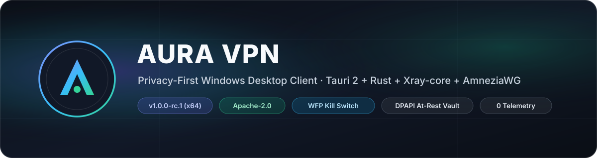
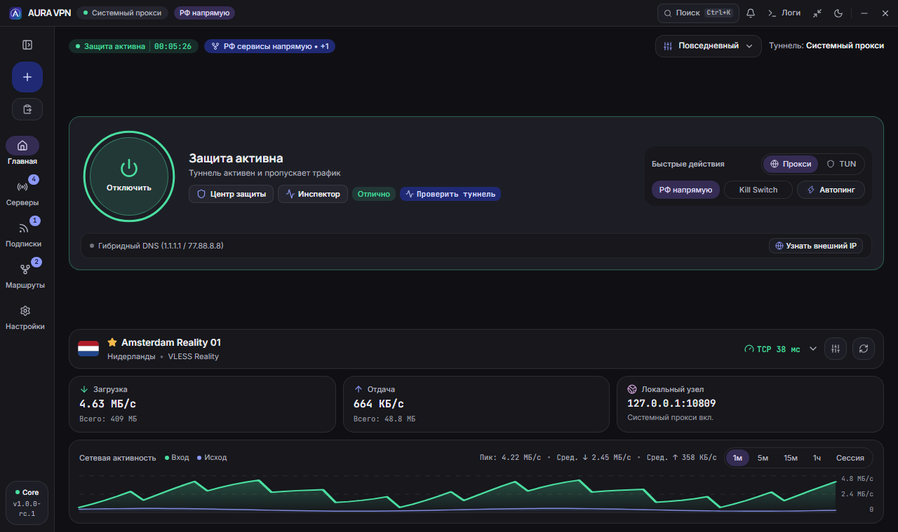
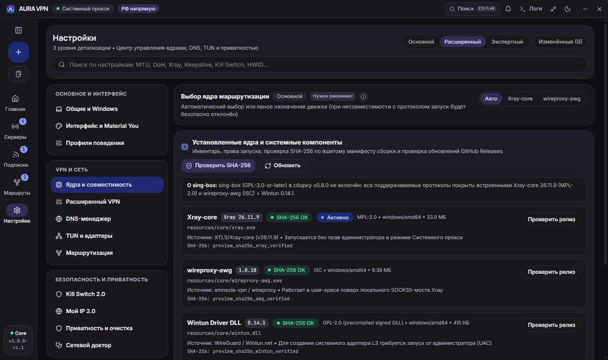
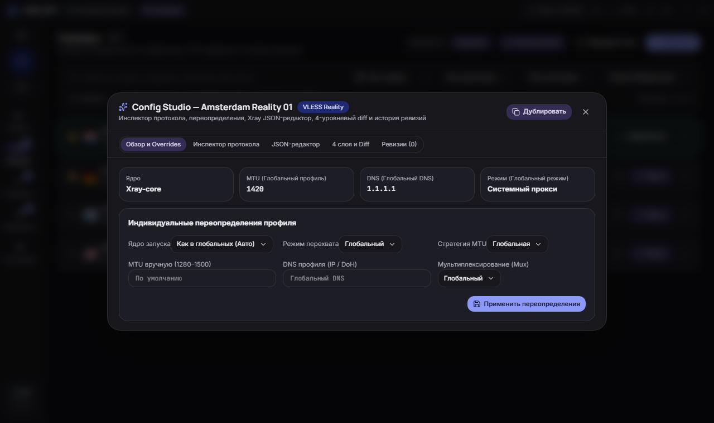

<p align="center">
  
</p>

<p align="center">
  <a href="README.ru.md">🇷🇺 Читать на русском (Russian)</a> ·
  <a href="#security--transparency-dashboard">Security &amp; Transparency</a> ·
  <a href="#installation--checksum-verification">Installation</a> ·
  <a href="SECURITY.md">Security Policy</a> ·
  <a href="ARCHITECTURE.md">Architecture</a>
</p>

<p align="center">
  
  
  
  
</p>

---

**AURA VPN** is an open-source, privacy-first Windows desktop VPN client built with **Tauri 2**, **Rust**, **React 19**, and **Material 3 Expressive**, orchestrating pinned **Xray-core (`v26.11.9`)**, **wireproxy-awg (`v1.0.18`)**, and **Wintun (`0.14.1`)**.

> **Pre-Release Notice (`v1.0.0-rc.1`)**: This Release Candidate is published as a GitHub Prerelease. Windows binaries (`aura-vpn.exe` and `AURA VPN_1.0.0-rc.1_x64-setup.exe`) are currently **unsigned** (no Authenticode certificate yet), so Windows SmartScreen will show an *"Unknown publisher"* warning. Always verify `SHA256SUMS.txt` before running. Clean multi-VM testing across fresh Windows SKUs is still in progress ahead of `v1.0.0` GA.

---

## Security & Transparency Dashboard

| Pillar | Guarantee / Implementation in `v1.0.0-rc.1` | Reference |
| --- | --- | --- |
| **At-Rest Encryption** | Server keys, Raw Xray JSON, subscription URLs & settings sealed via **Windows DPAPI (`CryptProtectData`)** | [PRIVACY.md](PRIVACY.md) |
| **Kill Switch Engine** | Kernel-level **Windows Filtering Platform (WFP)** blocking OS egress outside loopback, scoped DHCP, TUN LUID (`ConvertInterfaceAliasToLuid`), and verified core binaries (`ALE_APP_ID`), plus Proxy Guard fallback | [ARCHITECTURE.md](ARCHITECTURE.md) |
| **Binary Integrity** | Mandatory pre-launch SHA-256 check of `xray.exe` & `wireproxy-awg.exe` against build manifests; Authenticode-verified `wintun.dll` | [RELEASE_SECURITY.md](RELEASE_SECURITY.md) |
| **Anti-SSRF & Parsing** | Private/loopback/CGNAT/link-local IP blocking, DNS lookup pinning, depth-limited Clash YAML & sanitized Raw Xray JSON | [THREAT_MODEL.md](THREAT_MODEL.md) |
| **Telemetry** | **Zero** analytics, remote crash trackers, or third-party font CDNs; idle client sends zero packets | [NETWORK_BEHAVIOR.md](NETWORK_BEHAVIOR.md) |
| **Supply Chain** | **CycloneDX 1.5 SBOM (`SBOM.json`)**, SHA-pinned CI workflows, `cargo clippy -D warnings`, Gitleaks, RustSec & CodeQL ready | [THIRD_PARTY_NOTICES.md](THIRD_PARTY_NOTICES.md) |

---

## Screenshots

<table>
  <tr>
    <td align="center" width="50%">
      <br />
      <sub><strong>Home Dashboard</strong> — One-click tunnel, live RX/TX throughput, quick toggles &amp; latency</sub>
    </td>
    <td align="center" width="50%">
      <br />
      <sub><strong>Core &amp; Security Settings</strong> — SHA-256 verified cores, WFP Kill Switch, DNS &amp; Privacy Center</sub>
    </td>
  </tr>
  <tr>
    <td align="center" colspan="2">
      <br />
      <sub><strong>Config Studio</strong> — 4-layer config synthesis, per-profile overrides &amp; sanitized Xray JSON editor</sub>
    </td>
  </tr>
</table>

---

## Key Capabilities

- **Protocols**: `VLESS` (XTLS Vision, Reality, XHTTP/SplitHTTP, gRPC, WebSocket, TCP/KCP), `VMess`, `Trojan`, `Shadowsocks`, `Hysteria2`, `WireGuard`, `AmneziaWG`, and sanitized `Raw Xray JSON`.
- **Import Formats**: Share URIs (`vless://`, `vmess://`, `trojan://`, `ss://`, `hysteria2://`, `wireguard://`), WireGuard/AWG `.conf` INI files, Clash/Mihomo YAML profiles, and HTTPS/HTTP subscriptions.
- **Connection Modes**: Non-admin **System Proxy** mode or elevated **L3 TUN (`wintun.dll`)** with configurable MTU, bypass-LAN, and strict routing.
- **Security & Leak Protection**: Multi-mode Kill Switch (`off`, `on_drop`, `always_on`, `routing_aware`), DNS Mode Manager (`VPN`, `Hybrid`, `Config`, `System`, `Custom DoH/DoT`), My IP & Leak Monitor, Network Doctor, and HWID rotation.
- **Smart Config Studio**: Automatic compatibility diagnostics, 4-layer config diff viewer, and guarded Raw Xray JSON editing with revisions.
- **Privacy Center & Log Redaction**: Instant purge of history, DPAPI secrets, logs, and WebView2 state; centralized redaction across logs and diagnostics exports.

---

## Installation & Checksum Verification

1. Download `AURA VPN_1.0.0-rc.1_x64-setup.exe` and `SHA256SUMS.txt` from [GitHub Releases](https://github.com/donatefrost-cell/aura-vpn/releases/tag/v1.0.0-rc.1).
2. Verify the installer SHA-256 hash in PowerShell before running:
   ```powershell
   Get-FileHash ".\AURA VPN_1.0.0-rc.1_x64-setup.exe" -Algorithm SHA256
   Get-Content ".\SHA256SUMS.txt"
   ```
3. Run the installer. If Windows SmartScreen warns about an *Unknown publisher*, click **More info -> Run anyway** only after confirming the SHA-256 matches `SHA256SUMS.txt`.
4. Launch **AURA VPN**. Use **System Proxy** as a standard user or run as **Administrator** for **TUN** and **WFP Kill Switch**.

---

## Pinned Native Binaries (`windows-amd64`)

| Component | Version | License | Binary SHA-256 |
| --- | --- | --- | --- |
| `xray.exe` | `v26.11.9` | `MPL-2.0` | `1ca7a2cf61ba2c5d20b21a80d405b57933939751081cb289f07bd8ddf7cc3185` |
| `wireproxy-awg.exe` | `v1.0.18` | `ISC` | `3e59b2c518cf2402f8d858caf977205dfa9277703eddb266a34395c93674bbec` |
| `wintun.dll` | `0.14.1` | Wintun Prebuilt License (`WireGuard LLC`) | `e5da8447dc2c320edc0fc52fa01885c103de8c118481f683643cacc3220dafce` |

---

## Building from Source (Windows 10/11 x64)

Prerequisites: **Node.js 22**, **Rust (stable MSVC)**, **Visual Studio 2022 Build Tools (C++ & Windows SDK)**, and **WebView2 Runtime**.

```powershell
git clone https://github.com/donatefrost-cell/aura-vpn.git
cd aura-vpn
npm ci
npm run download-core
npm run test
npm run sbom
npm run tauri build
```

Output installer path: `src-tauri\target\release\bundle\nsis\AURA VPN_1.0.0-rc.1_x64-setup.exe`.

---

## Documentation & License

- [SECURITY.md](SECURITY.md) — Vulnerability disclosure & security model
- [ARCHITECTURE.md](ARCHITECTURE.md) — System & IPC design
- [THREAT_MODEL.md](THREAT_MODEL.md) — Trust boundaries & threat mitigations
- [NETWORK_BEHAVIOR.md](NETWORK_BEHAVIOR.md) — Complete outbound network inventory
- [PRIVACY.md](PRIVACY.md) — Local DPAPI storage & redaction policy
- [RELEASE_SECURITY.md](RELEASE_SECURITY.md) — Checksum & provenance verification
- [SECURITY_AUDIT.md](SECURITY_AUDIT.md) — Pre-release audit findings & limitations
- [THIRD_PARTY_NOTICES.md](THIRD_PARTY_NOTICES.md) — Third-party licenses & notices
- [CHANGELOG.md](CHANGELOG.md) — Version history

Licensed under the **Apache License, Version 2.0** ([LICENSE](LICENSE)).
