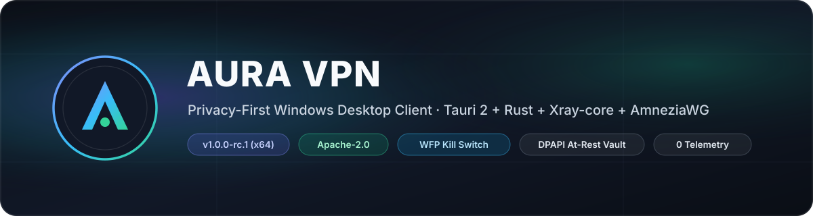
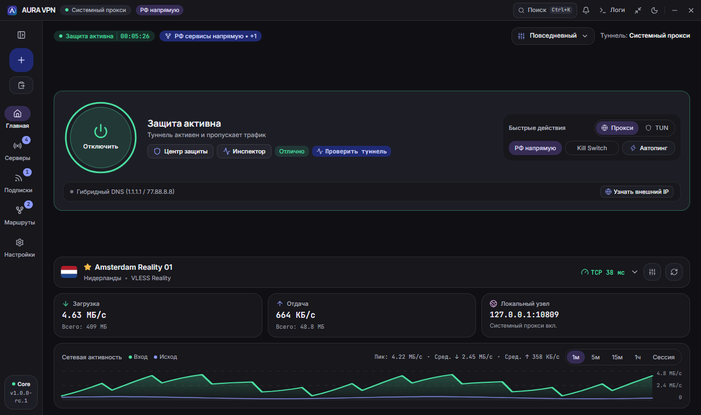
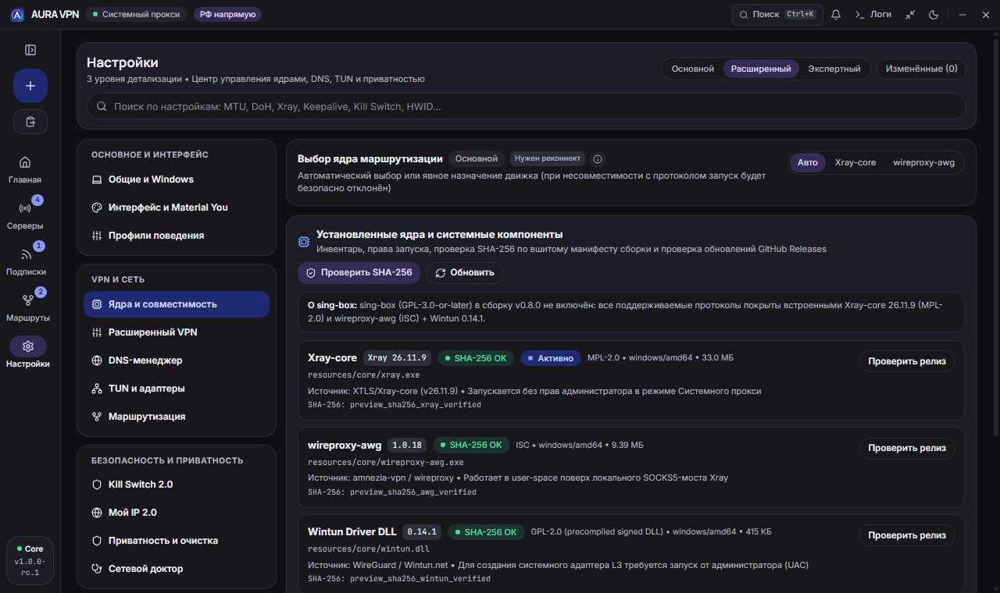
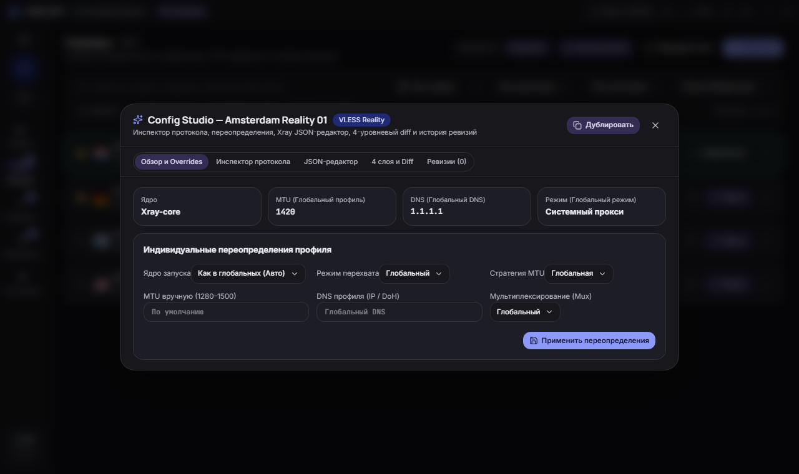

<p align="center">
  
</p>

<p align="center">
  <a href="README.md">🇬🇧 English Version</a> ·
  <a href="#панель-безопасности-и-прозрачности">Безопасность</a> ·
  <a href="#установка-и-проверка-хешей">Установка</a> ·
  <a href="SECURITY.md">Security Policy</a> ·
  <a href="ARCHITECTURE.md">Архитектура</a>
</p>

<p align="center">
  
  
  
  
</p>

---

**AURA VPN** — открытый десктопный VPN-клиент для Windows с акцентом на приватность и защиту от утечек. Построен на **Tauri 2**, **Rust**, **React 19** и **Material 3 Expressive**, использует проверенные по SHA-256 ядра **Xray-core (`v26.11.9`)**, **wireproxy-awg (`v1.0.18`)** и **Wintun (`0.14.1`)**.

> **Важное уведомление о Release Candidate (`v1.0.0-rc.1`)**: Версия опубликована как GitHub Prerelease. Исполняемый файл `aura-vpn.exe` и установщик `AURA VPN_1.0.0-rc.1_x64-setup.exe` пока **не подписаны коммерческим Authenticode-сертификатом**, поэтому Windows SmartScreen может показать предупреждение «Неизвестный издатель». Обязательно сверяйте SHA-256 с `SHA256SUMS.txt`. Матрица тестов на чистых виртуальных машинах Windows 10/11 планируется до финального `v1.0.0`.

---

## Панель безопасности и прозрачности

| Механизм | Реализация в `v1.0.0-rc.1` | Документ |
| --- | --- | --- |
| **Шифрование данных** | Профили, ключи, Raw Xray JSON, подписки и настройки зашифрованы через **Windows DPAPI (`CryptProtectData`)** | [PRIVACY.md](PRIVACY.md) |
| **Kill Switch (WFP)** | Системные фильтры **Windows Filtering Platform**, блокирующие трафик вне loopback, локального DHCP, LUID адаптера TUN (`ConvertInterfaceAliasToLuid`) и проверенных бинарников ядер (`ALE_APP_ID`), плюс Proxy Guard | [ARCHITECTURE.md](ARCHITECTURE.md) |
| **Контроль целостности** | Обязательная проверка SHA-256 `xray.exe` и `wireproxy-awg.exe` перед запуском туннеля и Config Studio; проверка подписи `WireGuard LLC` у `wintun.dll` | [RELEASE_SECURITY.md](RELEASE_SECURITY.md) |
| **Защита от SSRF и инъекций** | Блокировка локальных/частных/CGNAT IP, DNS-пиннинг, лимит глубины Clash YAML, санитайзер Raw Xray JSON и блокировка прямых запросов при активном Kill Switch | [THREAT_MODEL.md](THREAT_MODEL.md) |
| **Нулевая телеметрия** | Отсутствуют аналитика, внешние шрифтовые CDN и скрытые фоновые соединения | [NETWORK_BEHAVIOR.md](NETWORK_BEHAVIOR.md) |
| **Цепочка поставок** | Стандартный **CycloneDX 1.5 SBOM (`SBOM.json`)**, GitHub Actions с 40-символьными SHA, Gitleaks, RustSec и CodeQL | [THIRD_PARTY_NOTICES.md](THIRD_PARTY_NOTICES.md) |

---

## Скриншоты интерфейса

<table>
  <tr>
    <td align="center" width="50%">
      <br />
      <sub><strong>Главный экран</strong> — подключение в 1 клик, график скорости, быстрые режимы и пинг</sub>
    </td>
    <td align="center" width="50%">
      <br />
      <sub><strong>Настройки и безопасность</strong> — контроль SHA-256 ядер, Kill Switch 2.0, DNS и приватность</sub>
    </td>
  </tr>
  <tr>
    <td align="center" colspan="2">
      <br />
      <sub><strong>Config Studio</strong> — 4 слоя конфигурации, Diff, переопределения и безопасный JSON-редактор Xray</sub>
    </td>
  </tr>
</table>

---

## Основные возможности

- **Протоколы**: `VLESS` (XTLS Vision, Reality, XHTTP/SplitHTTP, gRPC, WebSocket, TCP/KCP), `VMess`, `Trojan`, `Shadowsocks`, `Hysteria2`, `WireGuard`, `AmneziaWG`, `Raw Xray JSON`.
- **Импорт**: ссылки `vless://`, `vmess://`, `trojan://`, `ss://`, `hysteria2://`, `wireguard://`, файлы `.conf` WireGuard/AWG, YAML-профили Clash/Mihomo и подписки по URL/буферу обмена.
- **Режимы работы**: **Системный прокси** (без прав администратора) и **TUN (`wintun.dll`)** с настройкой MTU, обхода LAN и строгого маршрута.
- **Безопасность**: Kill Switch (`off`, `on_drop`, `always_on`, `routing_aware`), DNS-менеджер (`VPN`, `Hybrid`, `Config`, `System`, `Custom DoH/DoT`), «Мой IP и проверка утечек», «Сетевой доктор», ротация HWID и полная очистка данных.
- **Удобство**: автовыбор лучшего сервера, пресет «РФ напрямую», компактный мини-режим, палитра команд (`Ctrl+K`) и адаптивный Material You.

---

## Установка и проверка хешей

1. Скачайте `AURA VPN_1.0.0-rc.1_x64-setup.exe` и `SHA256SUMS.txt` со страницы [GitHub Releases](https://github.com/donatefrost-cell/aura-vpn/releases/tag/v1.0.0-rc.1).
2. Сверьте контрольную сумму в PowerShell перед запуском:
   ```powershell
   Get-FileHash ".\AURA VPN_1.0.0-rc.1_x64-setup.exe" -Algorithm SHA256
   Get-Content ".\SHA256SUMS.txt"
   ```
3. Запустите установщик. Если SmartScreen покажет предупреждение о неподписанном файле, нажмите **Подробнее -> Выполнить в любом случае** только после совпадения SHA-256.
4. Для режима **TUN** и **WFP Kill Switch** запускайте клиент от имени администратора.

---

## Сборка из исходников (Windows 10/11 x64)

Требования: **Node.js 22**, **Rust stable (`x86_64-pc-windows-msvc`)**, **Visual Studio Build Tools 2022 (C++ и Windows SDK)**, **WebView2 Runtime**.

```powershell
git clone https://github.com/donatefrost-cell/aura-vpn.git
cd aura-vpn
npm ci
npm run download-core
npm run test
npm run sbom
npm run tauri build
```

Готовый установщик: `src-tauri\target\release\bundle\nsis\AURA VPN_1.0.0-rc.1_x64-setup.exe`.

Лицензия проекта: **Apache-2.0** ([LICENSE](LICENSE)). Сторонние компоненты перечислены в [THIRD_PARTY_NOTICES.md](THIRD_PARTY_NOTICES.md).
